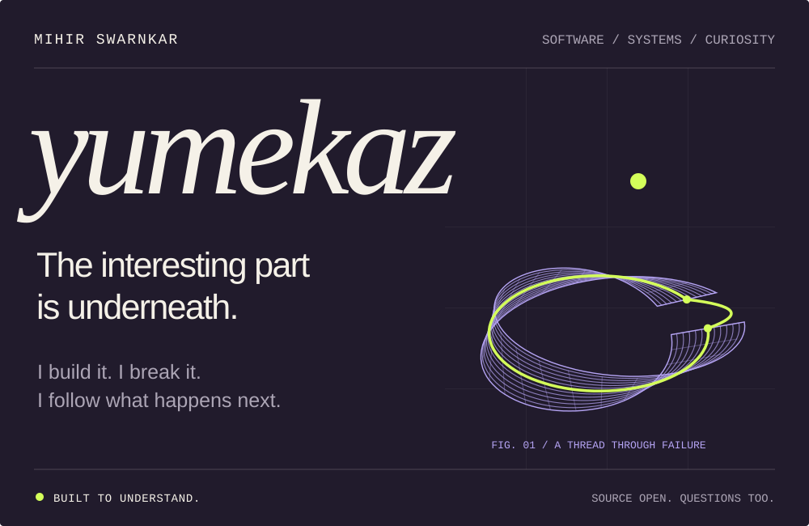

  

  <a href="https://yumekaz.vercel.app/"><strong>Portfolio</strong></a>
  &nbsp; / &nbsp;
  <a href="#selected-systems"><strong>Selected systems</strong></a>
  &nbsp; / &nbsp;
  <a href="https://yumekaz.vercel.app/notes/"><strong>Field notes</strong></a>
  &nbsp; / &nbsp;
  <a href="mailto:mihir.swarnkar722@gmail.com"><strong>Say hello</strong></a>

 

## Curiosity, made executable.

I'm **Mihir Swarnkar**, also known as **Yumekaz**. I build software to answer questions I can't settle by reading alone.

Most of my work lives in **distributed systems, correctness tooling, and the machinery beneath an application**. I'm especially interested in the moment a node disappears, a read goes stale, or a process stops halfway through a promise.

My favourite question: **what must remain true when the system fails?**

 

## Selected systems

Four questions. Four ways to investigate them.

<table>
  <tr>
    <td width="50%" valign="top">
      01 / COORDINATION
      <h3><a href="https://github.com/Yumekaz/Coordination-service">Coordination-service ↗</a></h3>
      
<strong>Who gets to lead when nodes disagree?</strong>

      
Replicated state, sessions, leases, watches, and recovery. A control-plane prototype that makes leadership and failure history inspectable.

      
<code>Python</code> <code>Replication</code> <code>Quorum</code>

    </td>
    <td width="50%" valign="top">
      02 / FAILURE TESTING
      <h3><a href="https://github.com/Yumekaz/FAILFORGE">FailForge ↗</a></h3>
      
<strong>Can we make the failure happen again?</strong>

      
Seeded fault schedules, invariant checks, and failure minimization. A lab for turning distributed-system failures into reproducible evidence.

      
<code>Go</code> <code>Fault injection</code> <code>Replay</code>

    </td>
  </tr>
  <tr>
    <td width="50%" valign="top">
      03 / RECOVERY
      <h3><a href="https://github.com/Yumekaz/Cairn">Cairn ↗</a></h3>
      
<strong>What survives an interrupted deploy?</strong>

      
A single-node Linux deployment platform exploring durable workflows, health gates, rollback, and reconciliation after interruption.

      
<code>Go</code> <code>Durability</code> <code>Linux</code>

    </td>
    <td width="50%" valign="top">
      04 / CORRECTNESS
      <h3><a href="https://github.com/Yumekaz/Qydrel">Qydrel ↗</a></h3>
      
<strong>Do different runtimes mean the same thing?</strong>

      
A small Rust language and runtime lab with an independent oracle, backend comparisons, fuzzing, and a museum of minimized bugs.

      
<code>Rust</code> <code>Compilers</code> <code>Fuzzing</code>

    </td>
  </tr>
</table>

### A failure worth reading

In **[Mini-Redis-Cassandra](https://github.com/Yumekaz/Mini-Redis-Cassandra)**, acknowledged writes were followed by stale reads. Investigating that failure exposed a mismatch between write quorums and read guarantees, along with persistence and transport issues.

The repository follows the trail through the failure, the fixes, and the reruns.

 

## Elsewhere in the workshop

I also build tools and applications around reading, code exploration, and learning by implementation.

| Project | The idea |
| :--- | :--- |
| **[Yomikura](https://github.com/Yumekaz/Yomikura)** | A Suwayomi library and reader client for desktop, web, and PWA. |
| **[Orbits](https://github.com/Yumekaz/Orbits)** | Map a codebase's structure and runtime connections before changing it. |
| **[TinyTantrum](https://github.com/Yumekaz/TinyTantrum)** | Learn the machinery of a GPT through implementation, evaluation, and recovery. |

<strong>Open the systems drawer</strong>

 

| Project | Investigation |
| :--- | :--- |
| **[DRT](https://github.com/Yumekaz/DRT)** | Record and replay concurrency failures in Python programs using explicit scheduling points. |
| **[DuraFlow](https://github.com/Yumekaz/DURAFLOW)** | Checkpoint workflow steps and recover after interruption. |
| **[Mini-Docker](https://github.com/Yumekaz/Mini-Docker)** | Explore Linux isolation through namespaces, cgroups, OverlayFS, and lifecycle control. |
| **[BitNet Triton](https://github.com/Yumekaz/bitnet-1.58b-gemm-triton)** | Measure a packed ternary GEMM experiment against optimized FP16 baselines, including negative results. |

 

## How I work

1. **Name the guarantee.** Decide what must remain true and which failures the system must handle.
2. **Make the failure repeatable.** Keep the seed, trace, or smallest example that explains it.
3. **Leave a useful record.** Document the decision, the fix, and the limits that remain.

These repositories include focused prototypes and learning projects. Their design notes, tests, and documented boundaries are part of the work.

**Working materials** &nbsp; `Python` · `Go` · `Rust` · `TypeScript` · `Linux`

 

---

  <strong>Have an interesting system, a stubborn bug, or a good question?</strong> 
  I'd be glad to hear about it.

  <a href="mailto:mihir.swarnkar722@gmail.com">Email</a>
  &nbsp; · &nbsp;
  <a href="https://www.linkedin.com/in/mihirswarnkar/">LinkedIn</a>
  &nbsp; · &nbsp;
  <a href="https://yumekaz.vercel.app/resume.pdf">Résumé</a>
  &nbsp; · &nbsp;
  <a href="https://github.com/Yumekaz?tab=repositories">All repositories ↗</a>

