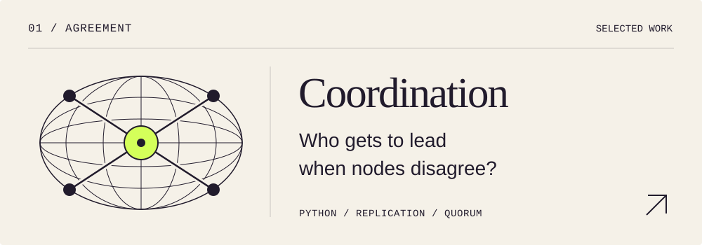
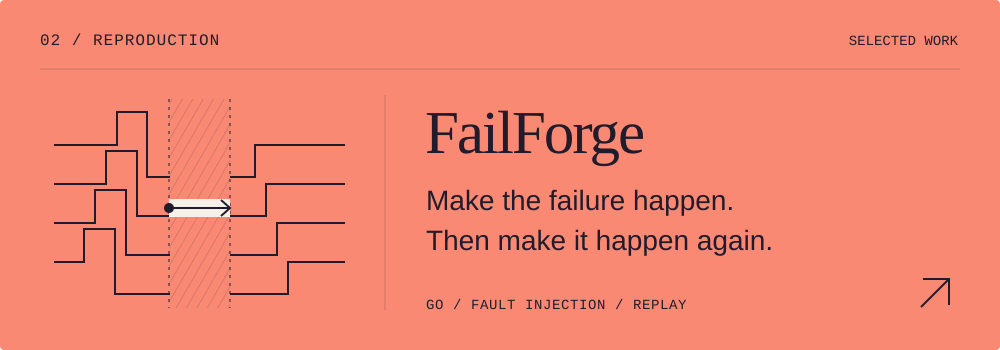
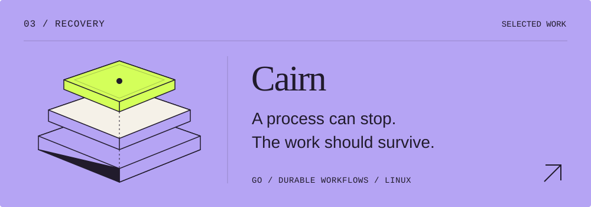
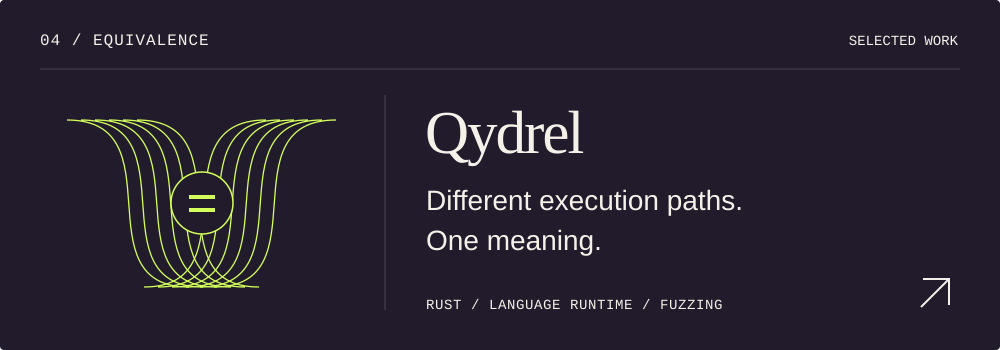
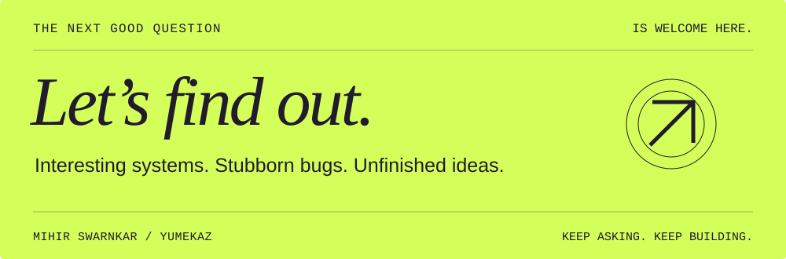

  <a href="https://yumekaz.vercel.app/"><strong>Portfolio ↗</strong></a>
  &nbsp; &nbsp; / &nbsp; &nbsp;
  <a href="https://yumekaz.vercel.app/notes/">Notes</a>
  &nbsp; &nbsp; / &nbsp; &nbsp;
  <a href="https://yumekaz.vercel.app/resume.pdf">Résumé</a>
  &nbsp; &nbsp; / &nbsp; &nbsp;
  <a href="mailto:mihir.swarnkar722@gmail.com">Say hello</a>

 

### Hello, I'm Mihir.

I build software to understand what happens underneath it: how nodes agree, what survives a crash, and whether two runtimes really mean the same thing.

Most of my work is in **distributed systems, developer tools, and correctness**. I like questions I can turn into an implementation, a failing test, or a trace worth reading.

`Python` &nbsp; `Go` &nbsp; `Rust` &nbsp; `TypeScript` &nbsp; `Linux`

 

## Four questions, made executable.

**[Coordination-service ↗](https://github.com/Yumekaz/Coordination-service)** · Replicated metadata, sessions, leases, and watches. A control-plane prototype exploring leadership, quorum-gated operations, and recovery.

**Look inside:** failover fencing and a history you can inspect when leadership changes.

 

**[FailForge ↗](https://github.com/Yumekaz/FAILFORGE)** · A local fault-testing lab with seeded schedules, invariant checks, replay, and failure minimization.

**Look inside:** the path from a failed run to a smaller, repeatable explanation.

 

**[Cairn ↗](https://github.com/Yumekaz/Cairn)** · A single-node Linux deployment platform built around durable workflows, health gates, rollback, and reconciliation.

**Look inside:** how interrupted deployment work is recovered and checked against reality.

 

**[Qydrel ↗](https://github.com/Yumekaz/Qydrel)** · A small language and runtime lab in Rust, with an independent oracle, backend comparisons, fuzzing, and minimized bugs.

**Look inside:** the bug museum, where disagreements become small examples worth keeping.

 

## One failure worth following.

**The write was acknowledged. The next read was stale.**

Testing **[Mini-Redis-Cassandra](https://github.com/Yumekaz/Mini-Redis-Cassandra)** with FailForge exposed a gap between what a successful write promised and what a later read could observe. The investigation reached into quorum rules, persistence, and transport ordering.

That's the kind of work I enjoy: follow a small contradiction until the system makes sense again.

[Explore the implementation and investigation ↗](https://github.com/Yumekaz/Mini-Redis-Cassandra)

 

## Curiosity takes other shapes.

**[Yomikura ↗](https://github.com/Yumekaz/Yomikura)**  
A Suwayomi library and reader client for desktop, web, and PWA. Systems thinking, brought to something you can sit down and use.

**[Orbits ↗](https://github.com/Yumekaz/Orbits)**  
Explore a codebase's structure and runtime connections before changing it.

**[TinyTantrum ↗](https://github.com/Yumekaz/TinyTantrum)**  
A from-scratch GPT lab: implementation, evaluation, checkpointing, and recovery.

<strong>Four more rabbit holes</strong>

 

- **[DRT](https://github.com/Yumekaz/DRT)** — Record and replay concurrency in Python through explicit scheduling points.
- **[DuraFlow](https://github.com/Yumekaz/DURAFLOW)** — Checkpoint workflow steps and recover after interruption.
- **[Mini-Docker](https://github.com/Yumekaz/Mini-Docker)** — Explore Linux isolation through namespaces, cgroups, OverlayFS, and lifecycle control.
- **[BitNet Triton](https://github.com/Yumekaz/bitnet-1.58b-gemm-triton)** — A packed ternary GEMM experiment, including the benchmarks where optimized FP16 wins.

 

### The habit behind the repositories

**Name the guarantee. Keep the counterexample. Document the limits.**

These are focused prototypes, experiments, and learning projects. The tests, failure cases, and design notes are part of what I'm building.

 

  <a href="mailto:mihir.swarnkar722@gmail.com"><strong>Email Mihir ↗</strong></a>
  &nbsp; &nbsp; / &nbsp; &nbsp;
  <a href="https://www.linkedin.com/in/mihirswarnkar/">LinkedIn</a>
  &nbsp; &nbsp; / &nbsp; &nbsp;
  <a href="https://github.com/Yumekaz?tab=repositories">All repositories</a>

